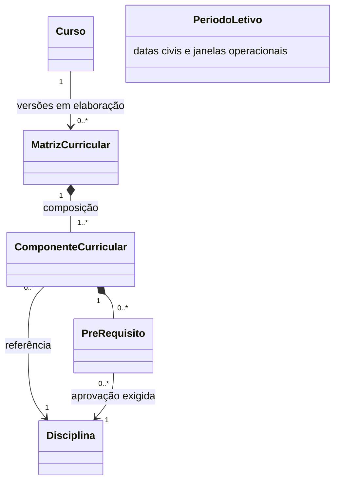

# ACA-02 — avaliação dos diagramas e arquitetura proposta

Data: 15/11/2026. Responsável: Dan/A — Acadêmico. Status: decisões de catálogo aprovadas por Dan nesta conversa em 15/11/2026; implementação de Curso e Disciplina disponível para revisão. Matriz em elaboração e componentes foram implementados em 15/11/2026; publicação, pré-requisitos e Período permanecem etapas seguintes. Não altera pontos nem declara aceite final.

## 1. Fontes e conclusões

Fonte principal: ../requisitos/Trabalho AMS 2026.pdf. Numeração abaixo corresponde às páginas do PDF. Foram examinados visualmente o DCU (figura 1, p.55), UC09 (p.60), classes (figura 9, p.139), sequência do Coordenador (figura 13, p.194), atividade do Coordenador (figura 24, p.218) e modelo lógico (figura 25, p.221). As imagens gerais de classes/banco têm letras pequenas; atributos e restrições foram conferidos nas descrições de classes e tabelas físicas, não inferidos de rótulos ilegíveis.

| Fonte | Evidência | Consequência arquitetural |
|---|---|---|
| RF-04, p.18 | Catálogo de cursos/disciplinas, ementa, carga horária, duplicidade e ciclos | Separar catálogo da oferta de turmas e da inscrição |
| RF-22, p.23; RN-06, p.48 | Matriz versionada e preservação da versão do aluno | Matriz é entidade própria; mudanças não podem alterar silenciosamente histórico |
| RF-30, p.25–26 | Datas, janelas operacionais e proteção dos registros vinculados | Período possui datas civis e janelas com horário; editar exige verificar impacto |
| DCU p.55 e UC09 p.60 | UC09 mistura criar disciplina, aluno/professor, sala e inscrição; DCU não detalha manutenção de curso/matriz/período | Não reproduzir esse fluxo misto no ACA-02; complementar casos de uso por função |
| Classes p.147–154, multiplicidades p.180 | Curso, Disciplina, MatrizCurricular, ComponenteCurricular, PreRequisito e PeriodoLetivo distintos | Modelar seis entidades, sem criar uma GradeCurricular concorrente |
| Figura 9 p.139 | Texto introdutório ainda menciona GradeCurricular, enquanto detalhamento utiliza MatrizCurricular | Adotar nomenclatura detalhada e do modelo físico; registrar divergência |
| Sequência p.194 | Cadastro genérico, fluxo de sucesso, sem transação, conflitos ou versionamento | Complementar sequência com autorização, validação, gravação/auditoria e rollback |
| Atividade p.218 | Barras de paralelismo ligam funcionalidades independentes; legenda cita parametrização mas desenho não detalha períodos/matrizes | Menu deve usar escolha de função, não executar todos os cadastros em paralelo |
| Físico p.235–240,245 | Unicidades, FKs, enums e checks explícitos | Base para migração com mapeamento abaixo |

Login será pré-condição de operações autenticadas. Não implementar a herança visual de Professor/Coordenador como Aluno do DCU: papéis já estão separados no ACA-01. Referência RN-18 em PreRequisito (p.151) diverge da RN-08 de inscrição; usar RF-04/RF-19 e a regra textual de ausência de ciclos, sem transportar números errados para testes.

## 2. Fronteira do incremento

Entregar manutenção de Cursos, Disciplinas, Períodos e Matrizes com componentes obrigatórios/eletivos e pré-requisitos. O ACA-02 não cria turma, sala, matrícula, inscrição ou resultado.

RF-22 também exige PlanoEstudo e ItemPlanoEstudo (p.152–153), que dependem de MatriculaCurso. O cartão ACA-02 cobre a estrutura curricular; a geração do plano individual precisa ficar explicitamente rastreada na integração com ACA-04, com atualização posterior por resultados/equivalências. Esta é uma proposta de divisão técnica, não retirada do RF-22 nem declaração de que ele estará integralmente concluído no ACA-02.

## 3. Modelo proposto

| Entidade | Campos centrais documentados | Invariantes |
|---|---|---|
| Curso | id, codigo, nome, cargaHorariaTotal, situacao | codigo único; carga > 0; ATIVO/INATIVO |
| Disciplina | id, codigo, nome, ementa, cargaHoraria, situacao | codigo único; carga > 0; ATIVA/INATIVA |
| MatrizCurricular | id, cursoId, codigo, versao, inicio/fim de vigência, situacao | UNIQUE(cursoId,codigo,versao); fim nulo ou >= início; EM_ELABORACAO/VIGENTE/ENCERRADA |
| ComponenteCurricular | id, matrizId, disciplinaId, tipo, periodoIdeal, cargaHorariaConsiderada | disciplina não se repete na matriz; período/carga > 0; OBRIGATORIO/ELETIVO |
| PreRequisito | id, componenteId, disciplinaId exigida, tipo, observacao | par único; APROVACAO_PREVIA; não autorreferente; não circular |
| PeriodoLetivo | id, descricao, dataInicio/Fim, inicio/fimMatricula, inicio/fimInscricao, situacao | cada fim >= início; PLANEJADO/ABERTO/ENCERRADO |



Decisão de Dan: matriz nunca vazia, inclusive em elaboração. Cabeçalho e pelo menos um componente devem ser confirmados na mesma transação. O Curso pode ser cadastrado antes da composição da sua matriz; a criação de matriz vazia não será exposta.

Carga do catálogo, carga considerada na matriz e carga total do curso são conceitos distintos. Somar componentes obrigatórios para calcularCargaHorariaObrigatoria; não impor igualdade automática com a carga total do curso, pois eletivas e outros componentes não têm política definida.

## 4. Organização em código

Preservar Java 21, Maven, Swing, JDBC/MySQL, Flyway e JUnit atuais. Sem novo framework, aplicação independente ou alterações em outros módulos.

Diretórios propostos sob src/main/java/br/edu/scoa/academico/:

- dominio/curriculo: Curso, Disciplina, MatrizCurricular, ComponenteCurricular, PreRequisito, enums e ValidadorPreRequisitos.
- dominio/periodos: PeriodoLetivo e validação das janelas.
- aplicacao/curriculo e aplicacao/periodos: casos de uso, DTOs, portas de repositório, autorização e erros estáveis.
- infraestrutura/persistencia: adaptadores JDBC que gravam cada alteração e sua auditoria na mesma transação.
- apresentacao/curriculo e apresentacao/periodos: controladores e painéis Swing; trabalho JDBC fora da EDT com SwingWorker.
- testes nos pacotes correspondentes de src/test/java; migrações em src/main/resources/db/academico.

MatrizCurricular será a unidade de consistência: componentes e pré-requisitos são alterados por seus casos de uso, não por CRUDs desconectados. Curso, Disciplina e PeriodoLetivo mantêm casos de uso próprios. Domínio não importa Swing/JDBC. Repositórios são interfaces de aplicação; DTOs públicos para futuros consumidores não expõem Connection nem entidades mutáveis internas.

Casos de uso: Cadastrar/Consultar/AtualizarCurso; Cadastrar/Consultar/AtualizarDisciplina; Criar/Consultar/EditarMatriz; Adicionar/Alterar/RemoverComponente em elaboração; Definir/RemoverPreRequisito; Validar/Publicar/CriarNovaVersaoMatriz; Cadastrar/Consultar/AtualizarPeriodo. Publicar e transições definitivas dependem das decisões de política abaixo.

Reutilizar Sessao/ServicoIdentidade. Decisão aplicada nesta etapa: Coordenador mantém a estrutura curricular; Aluno/Professor não administram o catálogo. Não conceder automaticamente novos acessos de leitura institucionais a esses perfis; suas consultas contextualizadas serão definidas nos incrementos consumidores.

## 5. Persistência, concorrência e histórico

Implementada V003__catalogo_curso_disciplina.sql, restrita a curso, disciplina e seus históricos. Matrizes, componentes, pré-requisitos e períodos receberão migrações posteriores. Preservar V001/V002 acadêmicas e histórico de identidade. Manter UNIQUE(id,curso_id) na matriz e UNIQUE(id,matriz_curricular_id) no componente para futuras FKs compostas de matrícula/plano. Não criar essas tabelas futuras prematuramente.

Mapear Date para LocalDate/DATE; janelas para Instant e DATETIME(6) em UTC, com entrada/exibição America/Sao_Paulo. Definir limites de intervalo explicitamente antes dos testes. Código e nome seguem tamanhos do físico (40 e 200); versao curricular VARCHAR(255), ementa/observação TEXT. Uma coluna adicional versao_registro BIGINT poderá controlar concorrência otimista: não confundir com a versao curricular de negócio.

Cada mutação de componentes/pré-requisitos bloqueia a linha da matriz (SELECT FOR UPDATE), carrega o grafo, valida e grava/audita na mesma transação. Isso impede que duas requisições insiram A→B e B→A simultaneamente. Usar DFS ou ordenação topológica no domínio; validação isolada antes da transação não basta. A abrangência do grafo por matriz e requisitos externos depende da decisão abaixo.

Decisão aprovada: composição publicada imutável; alterações estruturais geram nova versão de matriz, preservando a utilizada por cada aluno. Turmas de ingresso diferentes podem usar matrizes diferentes, escolhidas explicitamente na matrícula. Pré-requisitos devem pertencer à mesma matriz inicialmente.

Histórico explícito implementado para o catálogo: cada cadastro, edição e inativação gera snapshot em curso_historico ou disciplina_historico, na mesma transação do registro atual, com autor, instante UTC, origem e UUID de operação. Nenhum caso de uso altera snapshots antigos. A revisão técnica versao_registro também impede sobrescrita concorrente. Na futura implementação de ComponenteCurricular, a referência histórica deverá incluir disciplinaId e a revisão correspondente; referenciar apenas a linha atual de disciplina não atende à política aprovada. Essa ligação foi implementada na V004: componente_curricular referencia o par disciplina_id/disciplina_revisao de disciplina_historico. A atualização da referência em elaboração é explícita.

Inativação substitui exclusão física de cursos/disciplinas referenciados. Remoção de item em elaboração deve verificar se outro item o exige. Encerramento de período é distinto de homologação da pauta (ACA-08); até existir contrato real de dependências, não afirmar que foi validado fechamento de diários ou registros futuros. Ao integrar ACA-03/04, atualizar as verificações transacionais para datas de ofertas/inscrições.

## 6. Fluxos de tela

Menu: Cursos | Disciplinas | Matrizes curriculares | Períodos letivos. Cada menu oferece Cadastrar e Consultar; edição começa pela ficha encontrada. Busca usa código/nome para catálogo e descrição para período; usuário seleciona opções por nome/código, sem precisar digitar FKs.

Cadastro comum: dados → revisão → confirmação → resultado. Erros junto ao campo ou etapa pertinente; códigos de aplicação como CODIGO_DUPLICADO, CARGA_HORARIA_INVALIDA, INTERVALO_INVALIDO, PRE_REQUISITO_CICLICO, MATRIZ_NAO_EDITAVEL e CONFLITO_EDICAO. Cancelar não grava.

Matriz (elaboração implementada; publicação futura): selecionar curso → preparar versão com pelo menos um componente → salvar composição atomicamente → configurar pré-requisitos internos à matriz → validar → publicar após confirmação. Publicação é etapa própria; não publicar ao simplesmente salvar o cabeçalho. Período: separar visualmente calendário letivo, janela de matrícula e janela de inscrição.

```mermaid
sequenceDiagram
actor C as Coordenador
participant T as Tela Swing
participant A as Aplicação curricular
participant D as Regras de domínio
participant R as Repositório JDBC
C->>T: Confirmar pré-requisito
T->>A: Sessão + matriz + alteração esperada
A->>A: Verificar sessão e autorização
A->>R: Aplicar alteração atomicamente
R->>R: Iniciar transação e bloquear matriz
R->>D: Validar estado e grafo atualizado
alt Inválido ou edição concorrente
R-->>A: Rollback e código estável
A-->>T: Mensagem correspondente
else Válido
R->>R: Gravar alteração e auditoria; commit
R-->>A: DTO atualizado
A-->>T: Confirmação
end
```

O adaptador executa a operação transacional definida pela porta; a política curricular fica no domínio, não em strings SQL nem em listeners Swing.

## 7. Decisões aprovadas e pendências

Dan aprovou na conversa em 15/11/2026:

1. Matriz nunca vazia, inclusive em elaboração.
2. Preservar versões utilizadas pelos alunos; composição publicada congelada, mudança estrutural gera nova versão.
3. Permitir matrizes distintas para turmas de ingresso diferentes, com seleção explícita na matrícula.
4. Exigir pré-requisitos dentro da mesma matriz inicialmente.
5. Manter histórico explícito de mudanças de conteúdo de disciplina.

Convenções aplicadas ao catálogo: código com trim/strip e maiúsculas usando Locale.ROOT; unicidade dentro de cada catálogo; nomes com até 200 caracteres, código até 40, ementa obrigatória limitada à capacidade TEXT (65.535 bytes UTF-8), horas inteiras positivas. Coordenador mantém os cadastros. Não houve criação de novos acessos para Aluno/Professor. As tabelas usam BIGINT para identificadores/revisões e consultas parametrizadas. São decisões de implementação deste incremento, sem alteração de contratos externos.

Ainda pendentes para Período: política exata dos limites inclusivos das janelas e sua relação com início das aulas. A convivência de matrizes para alunos existentes não decide automaticamente quais versões aceitam novos ingressos; essa seleção precisa ficar explícita no futuro fluxo de matrícula. Não implementar restrições institucionais adicionais por hipótese.

## 8. Execução e TDD

1. Conferir estado Git e base do ACA-01 antes de abrir branch codex/aca-02-estrutura-curricular. Na análise, branch atual codex/aca-01-professores estava limpa; não foi feito checkout/merge/push.
2. Catálogos: testes de campos, códigos duplicados, cargas, autorização e conflito; implementar Curso/Disciplina, persistência e telas.
3. Períodos: testes de início/fim, limites, fuso e Clock controlado; implementar cadastro/consulta/edição.
4. Matriz/componente: unicidade, curso correto, disciplina existente, cargas próprias e composição em elaboração.
5. Pré-requisitos: próprio componente, repetição, ciclo direto/transitivo, não contaminar grafos de outras matrizes; duas gravações concorrentes tentando fechar ciclo.
6. Publicação/versionamento conforme decisões: histórico imutável, cópia com novos IDs e relações corretas, duplicidade de versão e transições recusadas.
7. MySQL: instalação limpa e upgrade desde ACA-01 sem perder dados; rollback de auditoria, FKs, unicidades, concorrência e consultas reabertas.
8. Swing: navegação por função, campo contextual, seleção de entidade, cancelamento, erro específico, EDT livre e duplo clique protegido.
9. Regressão ACA-01, demonstração sintética, evidências e roteiro manual; documentar fronteiras para ACA-03/04. Não marcar RF-22 completo enquanto o plano individual não estiver entregue.

## Estado desta entrega

A primeira parte do ACA-02 entrega Curso e Disciplina. Consulte ACA02_HOMOLOGACAO.md para comportamento, dados de demonstração, comandos e limitações. Matrizes em elaboração e componentes também estão implementados; consulte [homologação de matrizes](ACA02_MATRIZES_HOMOLOGACAO.md). Publicação/cópia de versões, pré-requisitos e períodos ainda não estão implementados; o ACA-02 e o RF-22 não estão concluídos. O PDF original foi preservado. Sem mudanças em módulos de outros integrantes, contratos externos ou dependências.

## Atualização — pré-requisitos, 16/11/2026

Implementados na V005, com relação por (matriz_id, disciplina_id, disciplina_exigida_id), FKs para os dois componentes da mesma matriz e tipo APROVACAO_PREVIA. O domínio valida o grafo sem ciclos; a transação bloqueia a matriz, confere revisão/situação, preserva a composição e grava os snapshots. A remoção de componente envolvido exige remover e salvar suas relações previamente. Consulte [homologação de pré-requisitos](ACA02_PRE_REQUISITOS_HOMOLOGACAO.md). Esta atualização supera as menções anteriores a pré-requisitos ainda não implementados; publicação/cópia de versões e períodos continuam pendentes.

## Publicação e cópia — implementação de 20/11/2026

Esta atualização substitui referências anteriores à publicação como pendente. Coordenador pode publicar uma matriz salva em elaboração e copiar uma publicada para nova versão em elaboração. Publicar congela identificação, vigência, componentes e pré-requisitos. O estado VIGENTE corresponde à publicação; estaVigente(data) exige também data dentro do intervalo inclusivo. Outras matrizes publicadas não são encerradas automaticamente.

A cópia pertence ao mesmo curso e preserva as revisões históricas das disciplinas, composição e pré-requisitos. Recebe novos IDs de matriz/componentes e matrizOrigemId rastreável. Código/versão devem ser únicos no curso. Não existe regra semântica nova para o texto da versão.

V006 acrescenta origem à matriz e ao histórico e identifica eventos ALTERACAO, PUBLICACAO e COPIA. Repositório bloqueia a linha de origem, confere revisão e valida o agregado real na transação. Gravação e auditoria são atômicas. Não há mudança nos contratos de outros módulos. Período letivo e integração com matrícula permanecem fora desta entrega. Ver ACA02_PUBLICACAO_HOMOLOGACAO.md.

## Período Letivo — implementação de 20/11/2026

Plano autorizado por Dan nesta conversa, incluindo as decisões propostas: cadastro Planejado; abertura explícita por Coordenador; janelas com limites inclusivos condicionadas a ABERTO; janelas independentes, podendo anteceder as aulas; encerramento explícito sem reabertura. As datas finais podem coincidir com as iniciais, conforme CHECKs do modelo. Descrição não é chave única. Estas decisões substituem a pendência anterior sobre limites das janelas.

PeriodoLetivo contém o calendário LocalDate e janelas Instant; métodos matriculaEstaAberta/inscricaoEstaAberta recebem o instante a avaliar, sem depender do relógio global. GestaoPeriodos verifica sessão/perfil e usa Clock para auditoria; RepositorioPeriodos define consulta, salvar e transicionar. JDBC grava datas civis em DATE e instantes como LocalDateTime UTC em DATETIME(6); a tela converte America/Sao_Paulo, preserva microssegundos na edição e recusa horários locais inexistentes/ambíguos.

Migração V007: periodo_letivo e periodo_historico, chave única operacao_criacao, revisão otimista e índice de situação/data. IDs BIGINT acompanham os demais cadastros do Acadêmico; este é o mapeamento explícito do INT documentado. Descrição mantém TEXT (até 65.535 bytes UTF-8). Toda escrita audita autor, instante UTC, evento, origem e UUID na mesma transação. Cadastro repetido com a mesma chave e payload retorna o resultado original, inclusive sob concorrência; mesma chave com outro payload/autor é recusada. Outra descrição igual com outra chave é permitida. Edição e transições desatualizadas são recusadas sem sobrescrita.

O fluxo de telas é calendário → matrícula → inscrição → revisão; consulta e ficha são próprias, assim como a confirmação de abertura/encerramento. Operações de persistência usam SwingWorker. Não há biblioteca nova.

Limitação explícita: ACA-03/04 ainda não fornecem turmas/inscrições/rematrículas para validar alterações de calendário contra registros vinculados. Ao implementar esses consumidores, é obrigatório integrar a verificação transacional das dependências do RF-30; não interpretar ausência de integração como validação concluída. Encerrar período não homologa pautas nem fecha diários. Sem remoção física de períodos. Matrículas, planos individuais e disponibilidade real de vagas não fazem parte desta entrega.

Publicação/cópia de matrizes foi revisada por Dan em 20/11/2026. Por decisão de Dan em 22/11/2026, a homologação manual de Períodos não é condição para este fechamento: ACA-02 está concluído tecnicamente com a regressão automatizada registrada em ACA02_PERIODOS_HOMOLOGACAO.md. As menções históricas acima a funcionalidades pendentes são superadas por esta seção.
